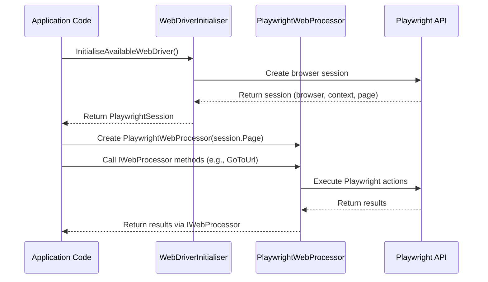

# NuciWeb.Automation.Playwright Architecture

This document describes the current architecture of the NuciWeb.Automation.Playwright library, which provides a Playwright-based implementation for the NuciWeb.Automation abstractions.

## 📑 Table of Contents
- [Purpose](#purpose)
- [System Context](#system-context)
- [Architectural Style](#architectural-style)
- [Runtime Flow](#runtime-flow)
- [Components](#components)
- [Dependency Direction and Rules](#dependency-direction-and-rules)
- [Deployment and Operations](#deployment-and-operations)
- [Design Constraints](#design-constraints)
- [Testing and Verification](#testing-and-verification)

## 🎯 Purpose
The NuciWeb.Automation.Playwright library implements the `IWebProcessor` interface from NuciWeb.Automation using Playwright to enable browser automation. It allows applications to drive real browsers (Firefox, Chromium, Webkit) while keeping higher-level automation logic independent from specific browser tooling. The library is intended for use in .NET applications requiring web automation capabilities.

## 🌐 System Context
The library operates within the .NET ecosystem and interacts with the following external systems:
- **NuciWeb.Automation:** Defines the `IWebProcessor` interface that this library implements.
- **Playwright (Microsoft.Playwright):** Provides the browser automation capabilities used by the library.
- **NuciWeb.HTTP:** Used for user agent fetching during browser session initialisation.
- **Application Code:** Consumes the library via the `IWebProcessor` interface to perform web automation tasks.

```mermaid
flowchart LR
    Application[Application Code] -->|Uses| Library[NuciWeb.Automation.Playwright]
    Library -->|Implements| NuciWebAutomation[NuciWeb.Automation (IWebProcessor)]
    Library -->|Depends on| Playwright[Microsoft.Playwright]
    Library -->|Uses| NuciWebHTTP[NuciWeb.HTTP]
```

The principal external boundaries are:
- **NuciWeb.Automation:** Contract interface (`IWebProcessor`) that the library must implement.
- **Playwright:** Browser automation library providing core functionality.
- **NuciWeb.HTTP:** Utility for fetching user agent strings.

## 🏗️ Architectural Style
The library follows a **Adapter** architectural style, where `PlaywrightWebProcessor` adapts the Playwright API to the `IWebProcessor` interface defined by NuciWeb.Automation. The `WebDriverInitialiser` acts as a **Factory** for creating configured Playwright browser sessions.

The principal architecture boundaries are:
- **Adapter Layer (`PlaywrightWebProcessor`):** Translates `IWebProcessor` method calls to Playwright API calls.
- **Session Factory (`WebDriverInitialiser`):** Creates and configures Playwright browser sessions (browser, context, page).
- **Abstraction Boundary:** The library depends only on the NuciWeb.Automation abstraction (`IWebProcessor`), not on concrete implementations.

## 🔄 Runtime Flow


The principal runtime sequence is:
1. Application calls `WebDriverInitialiser.InitialiseAvailableWebDriver()` to create a browser session.
2. Application instantiates `PlaywrightWebProcessor` with the session's main page.
3. Application uses the `IWebProcessor` interface to perform automation tasks.
4. `PlaywrightWebProcessor` translates each method call to corresponding Playwright API calls.
5. Playwright executes the actions in the browser and returns results.
6. Results are returned to the application via the `IWebProcessor` interface.

## 🧩 Components
| Component | Responsibility | Principal Dependencies | Lifetime or Ownership |
|-----------|----------------|------------------------|-----------------------|
| `PlaywrightWebProcessor` | Implements `IWebProcessor` using Playwright to perform web automation tasks | NuciWeb.Automation, Microsoft.Playwright | Scoped to application usage; created per automation session |
| `WebDriverInitialiser` | Factory for creating configured Playwright browser sessions (Firefox, Chromium, Webkit) | NuciWeb.HTTP, Microsoft.Playwright | Static methods; returns `PlaywrightSession` owned by caller |
| `PlaywrightSession` | Encapsulates an active Playwright browser session (playwright, browser, context, page) | Microsoft.Playwright | Owned by application; implements `IAsyncDisposable` for cleanup |

## 🧭 Dependency Direction and Rules
The library depends on stable abstractions and avoids depending on volatile concrete implementations. The permitted dependency direction is:
- **Dependencies point inward** toward the `IWebProcessor` abstraction defined by NuciWeb.Automation.
- **No dependencies** on application-specific code or higher-level automation logic.
- **External dependencies** are limited to NuciWeb packages and Microsoft.Playwright.

The principal dependency rules are:
- **Depend on NuciWeb.Automation abstraction:** Only depend on the `IWebProcessor` interface, not on any concrete implementations.
- **Encapsulate Playwright details:** Hide Playwright-specific types (`IPage`, `IBrowserContext`, etc.) within the library; expose only through the `IWebProcessor` interface.
- **Avoid circular dependencies:** No dependencies on other NuciWeb.Automation implementations or extensions.

## 🚀 Deployment and Operations
The library is distributed as a NuGet package and requires the following for operation:
- **.NET 10.0 or newer** runtime environment.
- **Playwright browsers** installed for the .NET runtime (via `pwsh bin/Debug/net10.0/playwright.ps1 install`).
- **NuGet package reference** to `NuciWeb.Automation.Playwright`.

| Concern | Current Design | Architectural Consequence |
|---------|----------------|---------------------------|
| **Process topology** | Library runs within the application process; no separate services or processes. | Simplifies deployment; no inter-process communication overhead. |
| **Persistent state** | No persistent state maintained by the library; all state is ephemeral within browser sessions. | Applications must manage their own state persistence if needed. |
| **Filesystem requirements** | Requires Playwright browser binaries to be available in the runtime environment. | Deployment must include browser binaries or ensure they are installable. |
| **Startup responsibilities** | Application must initialise browser session via `WebDriverInitialiser` before use. | Clear separation of concerns; initialisation is explicit and configurable. |
| **Shutdown responsibilities** | Application must dispose of `PlaywrightSession` to clean up browser resources. | Prevents resource leaks; disposal is required for proper cleanup. |
| **Operator-visible outputs** | None; all output occurs within the controlled browser session. | No logging, telemetry, or side effects outside browser automation. |

## ⚠️ Design Constraints
- **Adapter over Playwright:** The library is a thin adapter over Playwright, preserving its capabilities while conforming to the `IWebProcessor` interface. This limits functionality to what is expressible through the interface but ensures compatibility with NuciWeb.Automation.
- **Browser session management:** Browser sessions are created and managed by the application via `WebDriverInitialiser`, giving full control over browser lifecycle and configuration.
- **Headless mode support:** When debug mode is disabled, the library operates in headless mode and blocks common image requests to improve performance.
- **XPath selector usage:** The library uses XPath selectors throughout the `IWebProcessor` API, which may have performance implications compared to CSS selectors in some scenarios.
- **No direct Playwright exposure:** The library intentionally does not expose Playwright-specific types to maintain loose coupling and allow for potential future adapter changes.

## ✅ Testing and Verification
The library's architecture is verified through:
- **Unit tests** for `PlaywrightWebProcessor` and `WebDriverInitialiser` (not yet implemented in this repository).
- **Integration tests** using the NuciWeb.Automation test suite against the Playwright implementation.
- **Manual verification** of browser automation tasks (navigation, clicking, text input, etc.).
- **Example usage** in the README demonstrating typical workflows.

Execute the principal automated verification with:
```bash
dotnet test
```
when tests are available. Currently, verification relies on manual inspection and the NuciWeb.Automation test suite.